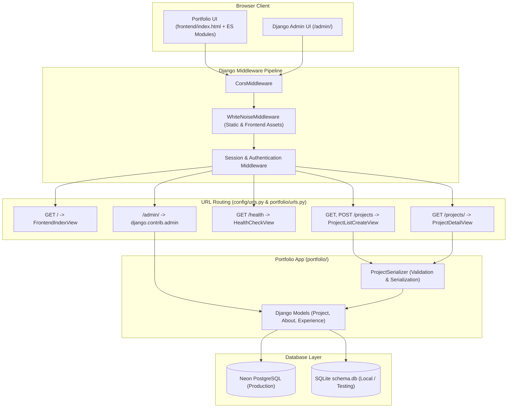
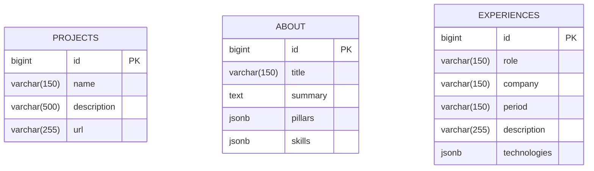

# Portfolio Software Architecture

## 1. System Overview

This repository implements a full-stack personal portfolio powered by **Django** and **Django REST Framework (DRF)** on the backend, paired with a modular **Vanilla JavaScript (ES Modules)** frontend and backed by **Neon Serverless PostgreSQL** in production (with **SQLite** fallback for local development and automated testing).

### Key Technology Stack
- **Backend Framework:** Django 6.x & Django REST Framework (DRF)
- **Database & ORM:** Django ORM with PostgreSQL (`psycopg` + `dj-database-url`) and SQLite fallback
- **Admin Management:** Built-in Django Admin (`/admin/`)
- **Static & Frontend Delivery:** WhiteNoise (`WHITENOISE_ROOT = BASE_DIR / "static"` and `TEMPLATES` serving `templates/index.html`)
- **CORS Management:** `django-cors-headers`
- **Testing & Quality:** `pytest`, `pytest-django`, `flake8`, `pylint` (`pylint-django`), and `black`
- **Hosting & CI/CD:** GitHub Actions + Vercel Serverless Python (`config.wsgi:app`)

---

## 2. High-Level Architecture Diagram



---

## 3. Directory Structure

```text
portfolio/
├── config/                     # Django project configuration package
│   ├── tests/                  # Configuration unit tests
│   │   └── settings_test.py
│   ├── __init__.py
│   ├── asgi.py                 # ASGI entrypoint
│   ├── settings.py             # Environment-aware settings (DB, CORS, WhiteNoise, DRF)
│   ├── urls.py                 # Root URL dispatcher (/admin/ and portfolio.urls)
│   └── wsgi.py                 # WSGI entrypoint (exposes `application` and `app` for Vercel)
├── portfolio/                  # Core portfolio Django application
│   ├── migrations/             # Database schema migrations
│   │   └── 0001_initial.py
│   ├── tests/                  # Portfolio domain & API tests
│   │   ├── models_test.py
│   │   ├── serializers_test.py
│   │   └── views_test.py
│   ├── admin.py                # Django Admin registrations (Project, About, Experience)
│   ├── apps.py                 # PortfolioConfig application definition
│   ├── models.py               # ORM models (Project, About, Experience)
│   ├── serializers.py          # DRF serializers & field/URL validations
│   ├── urls.py                 # Application routes (/, /health, /projects)
│   └── views.py                # DRF APIViews & FrontendIndexView
├── templates/                  # Django HTML templates
│   └── index.html              # Single-page portfolio HTML
├── static/                     # Static Vanilla JS frontend assets
│   ├── assets/                 # Images and static media
│   ├── css/
│   │   └── style.css           # Portfolio styles
│   └── js/
│       ├── components/         # Modular DOM renderers (about, experience, navbar, projects)
│       ├── api.js              # Fetch client for `/projects` endpoints
│       └── app.js              # Frontend entrypoint
├── .agents/
│   └── skills/
│       └── project-testing/    # Workspace Agent Skill for running tests & linters
├── manage.py                   # Django CLI management utility
├── pyproject.toml              # Project metadata & Vercel entrypoint config
├── requirements.txt            # Pinned Python dependencies
└── vercel.json                 # Vercel serverless function & static files configuration
```

---

## 4. Core Components & Responsibilities

### 4.1. Project Configuration (`config/`)
- **`config/settings.py`**:
  - Loads environment variables via `python-dotenv` when `TESTING != "1"`.
  - Dynamically selects the database engine in `get_database_config()`:
    - Uses **PostgreSQL** (`dj_database_url.parse` with `ssl_require=True` and `conn_max_age=0`) when `DATABASE_URL` is configured.
    - Falls back to **SQLite** (`/tmp/schema.db` on Vercel or `./schema.db` locally/testing).
  - Configures `WhiteNoiseMiddleware` with `WHITENOISE_ROOT = BASE_DIR / "static"` and `TEMPLATES` with `DIRS = [BASE_DIR / "templates"]` so frontend assets (`/css/style.css`, `/js/app.js`, `/assets/...`) and Django Admin static files are served directly without an external web server.
- **`config/wsgi.py`**:
  - Exposes both `application` (Django standard) and `app` (Vercel Python runtime convention).

### 4.2. Portfolio Application (`portfolio/`)
- **`portfolio/models.py`**:
  - Defines `Project` (`db_table = "projects"`), `About` (`db_table = "about"`), and `Experience` (`db_table = "experiences"`).
  - Preserves exact table and column compatibility with the existing PostgreSQL schema while expanding `Project.description` to `max_length=500`.
- **`portfolio/serializers.py`**:
  - `ProjectSerializer` validates `name` (1–100 chars), `description` (1–500 chars), and `url` (1–200 chars, enforcing `http://` or `https://` scheme).
- **`portfolio/views.py`**:
  - `FrontendIndexView`: Serves `templates/index.html` at `/`.
  - `HealthCheckView`: Returns `{"status": "ok"}` (`200 OK`) at `/health`.
  - `ProjectListCreateView`: Handles `GET /projects` and `POST /projects` using standardized response envelopes and structured error handling.
  - `ProjectDetailView`: Handles `GET /projects/<project_name>`.
- **`portfolio/admin.py`**:
  - Registers `Project`, `About`, and `Experience` in Django's built-in Admin interface at `/admin/` with search and list display columns.

---

## 5. Data Model (ER Diagram)



---

## 6. API Contract & Endpoints

| Method | Endpoint | Description | Success Status | Response Payload |
| :--- | :--- | :--- | :--- | :--- |
| `GET` | `/` | Serves the portfolio frontend (`templates/index.html`) | `200 OK` | `text/html` |
| `GET` | `/admin/` | Built-in Django Administration dashboard | `200 OK` / `302` | `text/html` |
| `GET` | `/health` | Service health check | `200 OK` | `{"status": "ok"}` |
| `GET` | `/experiences` | Lists all work experience entries | `200 OK` | `{"type": "EXPERIENCE", "count": N, "attributes": [...]}` |
| `POST` | `/experiences` | Registers a new work experience entry (Admin only) | `201 Created` | `{"type": "EXPERIENCE", "count": 1, "attributes": {...}}` |
| `GET` | `/projects` | Lists all registered portfolio projects | `200 OK` | `{"type": "PROJECT", "count": N, "attributes": [...]}` |
| `POST` | `/projects` | Registers a new project (Admin only) | `201 Created` | `{"type": "PROJECT", "count": 1, "attributes": {...}}` |
| `GET` | `/projects/<project_name>` | Retrieves projects matching `project_name` | `200 OK` | `{"type": "PROJECT", "count": N, "attributes": [...]}` |

### Standardized Error Responses
- **Validation Error (`400 Bad Request`)**:
  ```json
  {
    "detail": {
      "url": ["Project URL must be a valid URL"]
    }
  }
  ```
- **Server Error (`500 Internal Server Error`)**:
  ```json
  {
    "detail": "Internal server error"
  }
  ```

---

## 7. Testing & CI/CD Pipeline

1. **Automated Testing (`pytest` & `pytest-django`)**:
   - Configured via `pytest.ini` (`DJANGO_SETTINGS_MODULE = config.settings`) and `tests/conftest.py` (`TESTING=1`).
   - Tests run isolated against SQLite without mutating the production Neon PostgreSQL database.
2. **Static Analysis (`flake8` & `pylint`)**:
   - `flake8 .` enforces PEP 8 formatting (excluding `.venv` and `migrations`).
   - `pylint config portfolio manage.py` validates code quality across all Django modules.
3. **Deployment (`vercel.json` & `.github/workflows/ci_cd.yml`)**:
   - GitHub Actions runs linting and unit tests on every push and pull request to `main`, deploying prebuilt artifacts to Vercel only when both jobs succeed.
